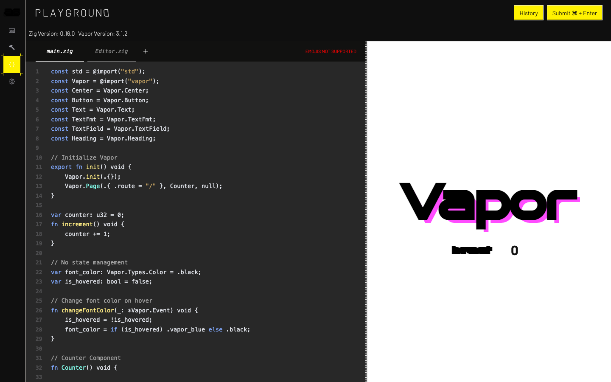
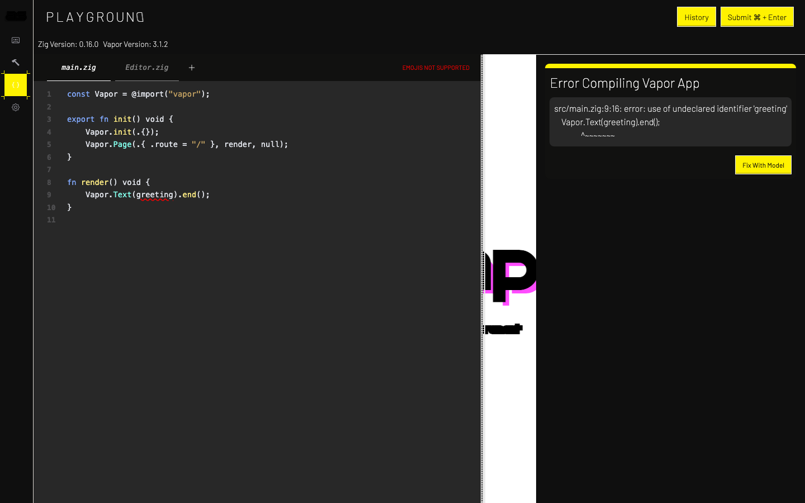

# Assembler

[](https://github.com/vic-Rokx/assembler-chat/actions/workflows/ci.yml)

A [vapor](https://github.com/senet-toolbox/vapor) app for writing vapor
apps. Describe a UI and a model writes the Zig for it; edit it in the
playground, where it is compiled to WebAssembly and runs beside its source.
The whole app is Zig, compiled to wasm and rendered by vapor's runtime. Its
server is [assembler-backend](https://github.com/vic-Rokx/assembler-backend).



## What's in it

- **Assembler**: describe a component and Claude or GPT writes it, against
  a system prompt of vapor 3.x's API. The call goes from your browser to
  the provider with your own key.
- **Playground**: a Zig editor with syntax highlighting. Submit sends the
  code to the backend, which builds it against vapor 3.1.2, and the result
  runs in a frame next to the editor. Compile errors are underlined where
  the compiler puts them.
- **Planner**: a markdown pad.
- **Settings**: your Anthropic, OpenAI or Google keys, or connect OpenAI
  Codex. Keys are kept only in this browser and sent only to their
  provider; the server never receives them.
- **Sign in with Google**, through vapor's KeyStone and the backend.



## How the playground runs code

1. Submit posts the editor's `main.zig` to the backend, which answers with
   a build id, or with the compiler's `file:line:col: error: ...` lines.
2. The errors are parsed (`src/routes/diagnostics.zig`) and each is
   underlined in the editor.
3. With an id, vapor's `runPlaygroundWasm` fetches the wasm, swaps in a
   fresh frame, and posts it the bytes. The frame is `playground.html`, a
   page marked `data-vapor-boot="playground"`, so vapor's runtime boots the
   bytes it is sent instead of fetching an app of its own.
4. The frame is served from another origin (`-Dplayground_url`). Your keys
   live in this app's storage, and code running in the frame cannot read
   it from there.

## Build and run

Zig 0.16.0. Every dependency is pinned in `build.zig.zon`, so a clone
builds on its own.

```sh
zig build site                 # zig-out/site/: what a static host serves
node scripts/serve.mjs         # the app on :5173, the frame on :5174
```

The playground and sign-in need
[assembler-backend](https://github.com/vic-Rokx/assembler-backend) running
(`zig build run` there, on :8080). Chat needs only your key, in Settings.

| Build option | Default | |
| --- | --- | --- |
| `-Dbackend_base_url` | `http://localhost:8080` | Where the backend is. |
| `-Dplayground_url` | `http://localhost:5174/playground.html` | The frame's page, on an origin other than the app's. |
| `-Doptimize` | `Debug` | `ReleaseSmall` for what you ship. |

For hosting, `zig-out/site/` goes on two hostnames of one site: the app on,
for example, `app.example.com`, and the same files on `play.example.com`
for the frame. Its `index.html` serves every route. The backend's README
covers the rest.

## Tests

```sh
zig build test      # unit tests: parsing the compiler's diagnostics
zig build check     # type-checks every route, used or not
```

The end-to-end tests live in assembler-backend, since they need it
running. They build the sample and wait for it to render in the frame,
check the frame cannot read the app's storage, check that a compile error is
underlined, and run a Google sign-in through to signing out.

## Built with

| | |
| --- | --- |
| [vapor](https://github.com/senet-toolbox/vapor) | The UI framework and runtime, and KeyStone for sign-in |
| [opaque-ui](https://github.com/senet-toolbox/opaque) | Components |
| [vaporize](https://github.com/senet-toolbox/vaporize) | The code editor and markdown |
| [assembler-backend](https://github.com/vic-Rokx/assembler-backend) | Builds, sign-in |
